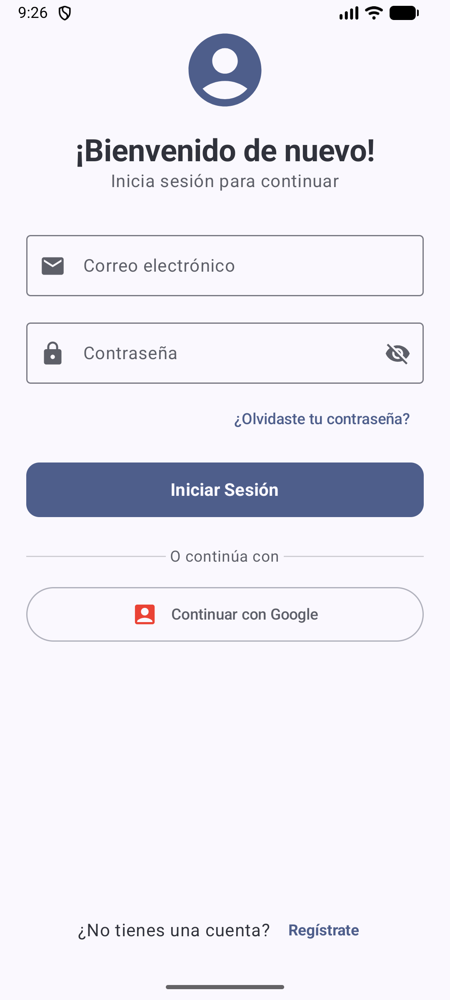
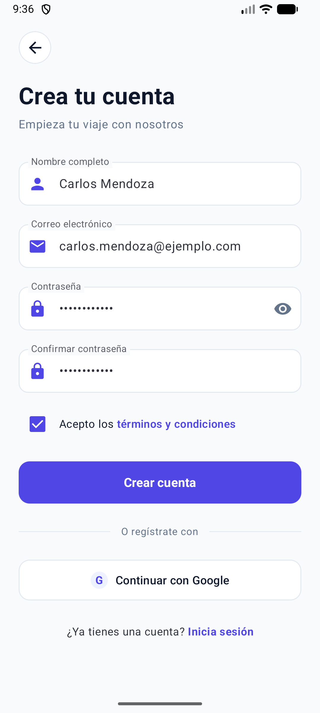
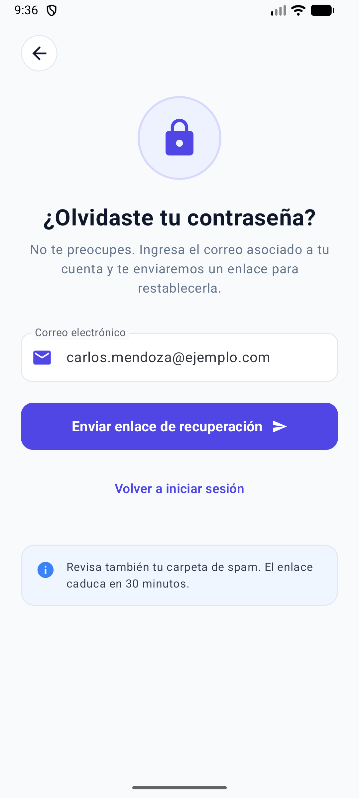

# Actividad 4 – Construcción de Login en Jetpack Compose

Aplicaciones Móviles Android · SENA ADSO · Manuela Córdoba Robledo

## Qué tiene

| Pantalla | Archivo | Cómo se hizo |
|----------|---------|--------------|
| Login | `ui/screen/LoginScreen.kt` | A mano, paso a paso (estados con `remember`, ojo para mostrar la contraseña) |
| Registro | `ui/screen/RegistroScreen.kt` | Diseño y código Jetpack Compose generados por Google Stitch (proyecto **AppLoginTutorial**, Prompt 1) |
| Recuperar contraseña | `ui/screen/RecuperarScreen.kt` | Diseño y código Jetpack Compose generados por Google Stitch (Prompt 2) |

`MainActivity.kt` abre la app en el Login.

Las pantallas de Registro y Recuperar son **solo diseño**: no usan `remember` ni `mutableStateOf`, los campos tienen valores de ejemplo y los botones tienen `onClick` vacío. Cada una tiene su `@Preview`.

### Cómo se adaptó el código de Stitch

Stitch entregó el código Kotlin en su respuesta del chat (la respuesta original está en [`docs/stitch/`](docs/stitch/)). Para que funcionara en este proyecto se le hicieron estos cambios, que también están anotados al inicio de cada archivo:

- **Package:** Stitch usó `com.example.app.ui.auth`; se cambió a `com.example.composable.ui.screen`, como pide la guía.
- **Nombres:** `RegisterScreen` → `RegistroScreen` y `ForgotPasswordScreen` → `RecuperarScreen`.
- **Sin `remember`:** Stitch agregó `verticalScroll(rememberScrollState())`; se quitó porque la actividad pide no usar `remember` y las pantallas caben completas sin scroll.
- **Barra de estado:** se agregó `systemBarsPadding()` para que la flecha de volver no quede debajo de la hora y la batería.
- **Preview:** usa `ComposableTheme`, el tema del proyecto, en vez de `MaterialTheme` solo.

## Las pantallas corriendo en el emulador

Capturas tomadas en el emulador (Medium Phone, API 37). Como la app no tiene navegación, para ver Registro y Recuperar se cambia en `MainActivity.kt` la pantalla que se llama dentro del `Surface`.

| Login | Registro | Recuperar contraseña |
|:---:|:---:|:---:|
|  |  |  |

## Cómo probarlo

1. Abrir el proyecto en Android Studio y hacer **Sync**.
2. Correr la app en el emulador: se ve el Login.
3. Para ver Registro o Recuperar, abrir su archivo y usar la vista **Split** o **Design** (Preview).
